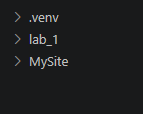
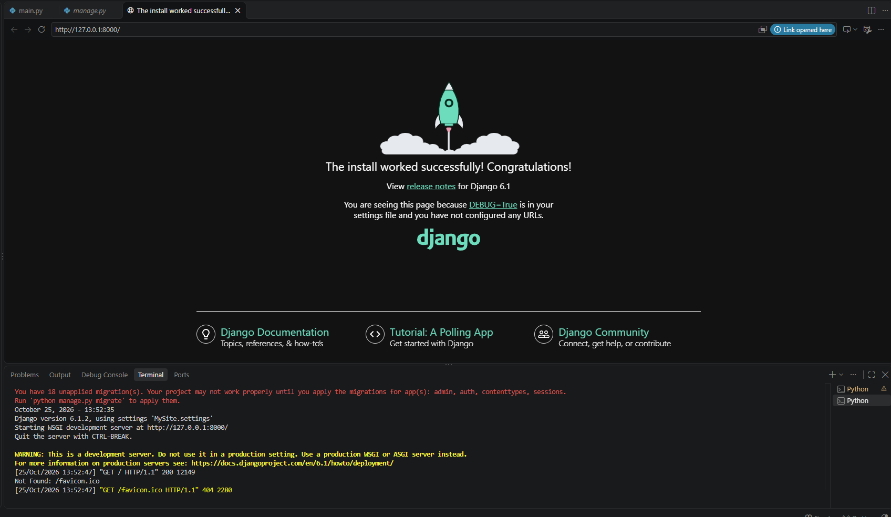
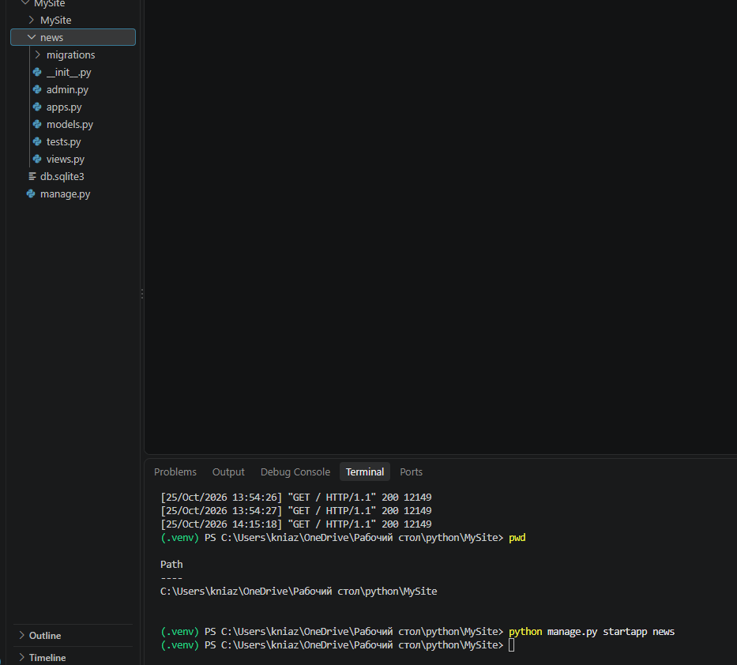
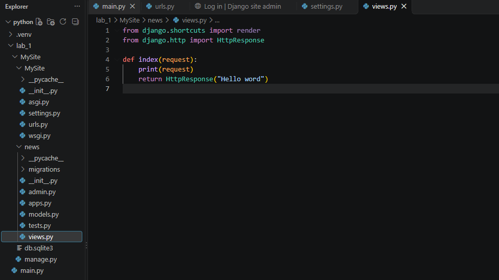
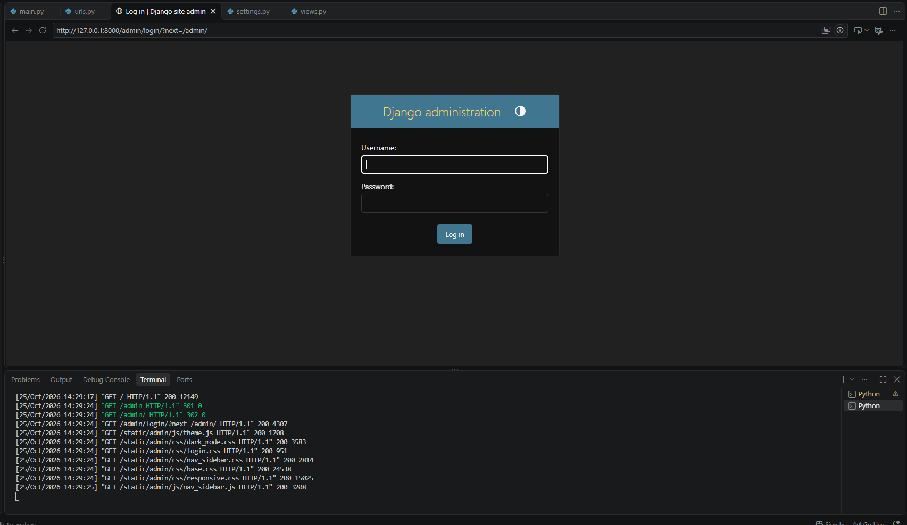
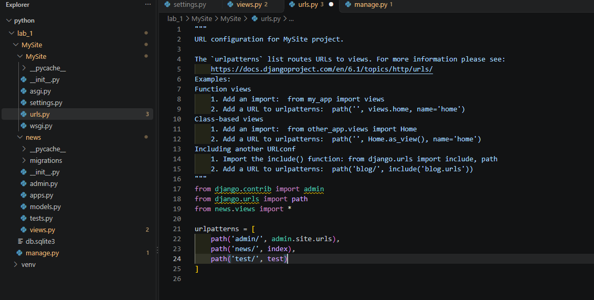
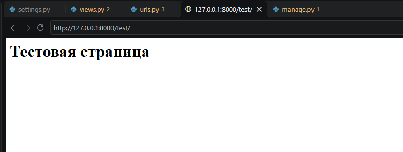
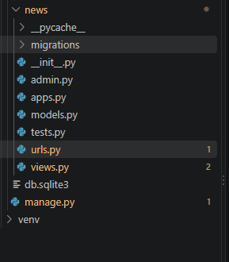
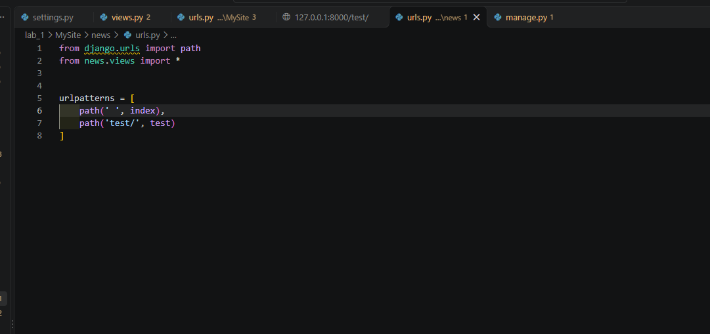
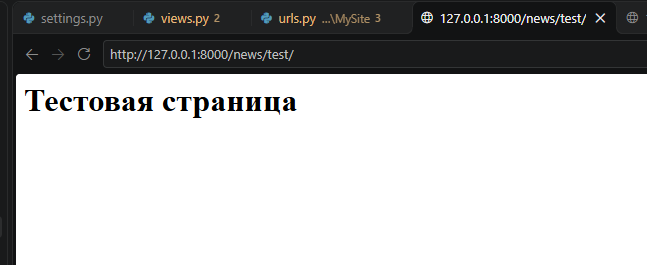

# Отчёт по лабораторной работе №1
## Создание виртуального окружения. Контроллеры и маршруты

**Выполнил:** Щербинин Данил Вячеславович  
**Группа:** ПИЖ-б-о-25-2  
**Год:** 2026

---

## 1. Цель работы

Настроить виртуальное окружение Python, создать проект на Django, разработать контроллеры приложения и настроить маршруты для обработки запросов.

## 2. Теоретические сведения

**Виртуальное окружение** — изолированная среда Python, позволяющая устанавливать библиотеки отдельно для каждого проекта.

**Django** — Python-фреймворк для разработки веб-приложений.

**Приложение Django** — отдельная часть проекта, отвечающая за определённый функционал сайта.

**Контроллер** — функция или класс, который принимает HTTP-запрос и возвращает ответ пользователю. В Django контроллеры обычно располагаются в файле `views.py`.

**Маршрут** — правило, связывающее URL-адрес с определённым контроллером. Маршруты настраиваются в файле `urls.py`.

## 3. Ход работы

**Создание виртуального окружения:**



**С помощью runserver запускаем шаблон будущего сайта:**



**С помошью ```python manage.py startapp news``` создаем новое приложение:**



**Напишем первую контроллер функцию в файле views.py:**



**Проверяем страницу админки:**



**Зададим маршрут для страницы test:**



**Посмотрим на страницу test:**



**Создадим файл urls.py для того чтобы хранить все маршруты в приложении news:**



**Импортируем в urls.py функцию path и создаем переменную urlpatterns со списком адресов:**



**Смотрим на результат вложенной страницы test:**




## 4. Контрольные вопросы

1. **Для чего нужно виртуальное окружение?**  
   Для изоляции библиотек и зависимостей проекта.

2. **Как создать виртуальное окружение?**  
   Командой `python -m venv venv`.

3. **Как активировать виртуальное окружение в Windows?**  
   Командой `venv\Scripts\activate`.

4. **Для чего используется команда `pip install Django`?**  
   Для установки Django в виртуальное окружение.

5. **Как создать проект Django?**  
   Командой `django-admin startproject MySite`.

6. **Для чего нужен файл `manage.py`?**  
   Для выполнения команд управления проектом Django.

7. **Как запустить сервер Django?**  
   Командой `python manage.py runserver`.

8. **Для чего создаются приложения Django?**  
   Для разделения функционала сайта на отдельные части.

9. **Где регистрируются приложения?**  
   В файле `settings.py`, в списке `INSTALLED_APPS`.

10. **Для чего нужен файл `views.py`?**  
    В нём создаются контроллеры, обрабатывающие запросы.

11. **Что такое HTTP-запрос?**  
    Это запрос клиента к серверу для получения или отправки данных.

12. **Для чего используется `HttpResponse`?**  
    Для формирования HTTP-ответа пользователю.

13. **Для чего нужен файл `urls.py`?**  
    Для настройки маршрутов и связи URL-адресов с контроллерами.

14. **Для чего используется функция `path()`?**  
    Для создания маршрута по определённому URL-адресу.

15. **Для чего используется функция `include()`?**  
    Для подключения маршрутов отдельного приложения к основному проекту.

## 4. Вывод

В ходе лабораторной работы были изучены принципы работы виртуального окружения Python и основы разработки веб-приложений на Django. Были рассмотрены контроллеры, HTTP-запросы и настройка маршрутизации. Закреплены навыки работы с основными инструментами Django.