# Лабораторная работа №2

**Дисциплина:** WEB  
**Тема:** Модели. CRUD  
**Студент:** Щербинин Данил Вячеславович  
**Группа:** ПИЖ-б-о-25-2  
**Год:** 2026

## 1. Цель работы

Изучить создание моделей в Django, типы полей моделей и работу с базой данных SQLite. Освоить создание и применение миграций, а также операции CRUD (создание, чтение, обновление и удаление записей) с помощью Django ORM в интерактивной консоли `shell`.

## 2. Теоретическая часть

**Модель Django** — Python-класс, унаследованный от `django.db.models.Model`, который описывает структуру данных. Как правило, каждой модели соответствует таблица базы данных, а полям модели — столбцы таблицы.

**Основные типы полей:**

- `CharField` — строка с ограничением длины (`max_length`).
- `TextField` — текст произвольной длины.
- `DateTimeField` — дата и время.
- `BooleanField` — логическое значение (`True` или `False`).
- `IntegerField` — целое число.
- `ImageField` — поле изображения, для которого требуется библиотека Pillow.

**Миграции** позволяют перенести изменения моделей в структуру базы данных:

- `python manage.py makemigrations` — создать файлы миграций;
- `python manage.py migrate` — применить миграции к базе данных;

## 3. Ход работы

**Задание:**

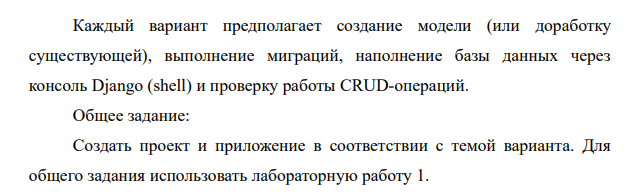

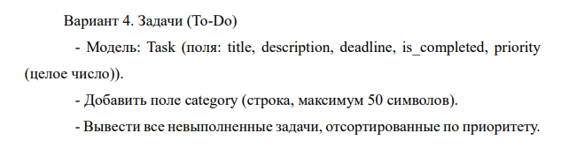

**Выполнение:**

Создал новую модель Task:

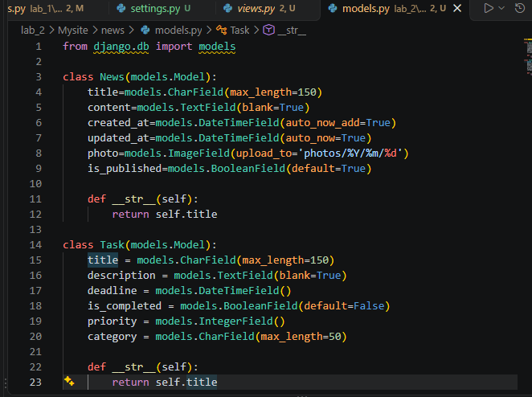

Cоздание миграции:

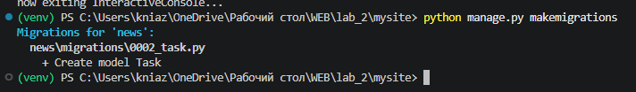

Применил миграцию:

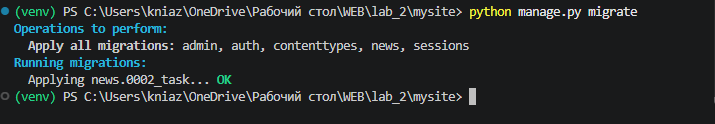

После успешного применения миграции в базе данных появилась таблица news_task:

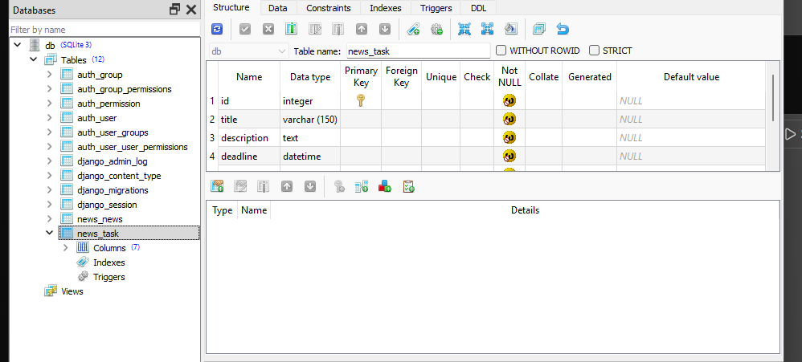

Создал первую задачу:

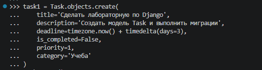

Задача в sqlitestudio:

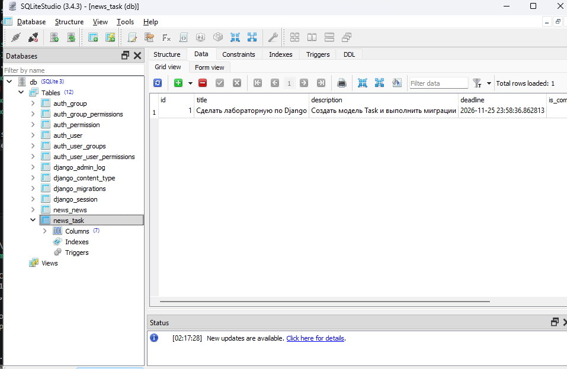

Создал остальные:

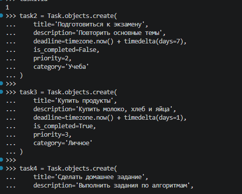

Вывод всех задач:

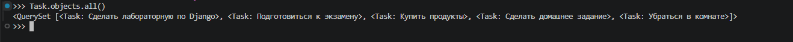

Оставшиеся CRUD-операции(READ):

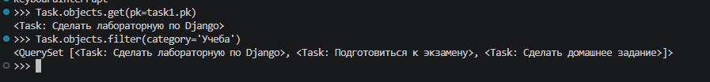

UPDATE-операция:

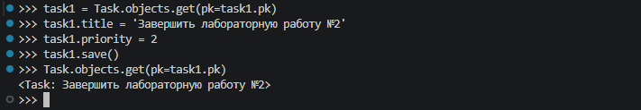

Delete-операция:

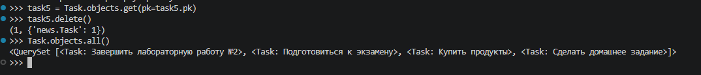

**Задание варианта - фильтарция по приоритету:**

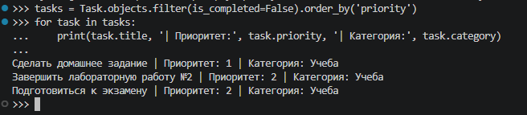

Sqlitestudio после операций:

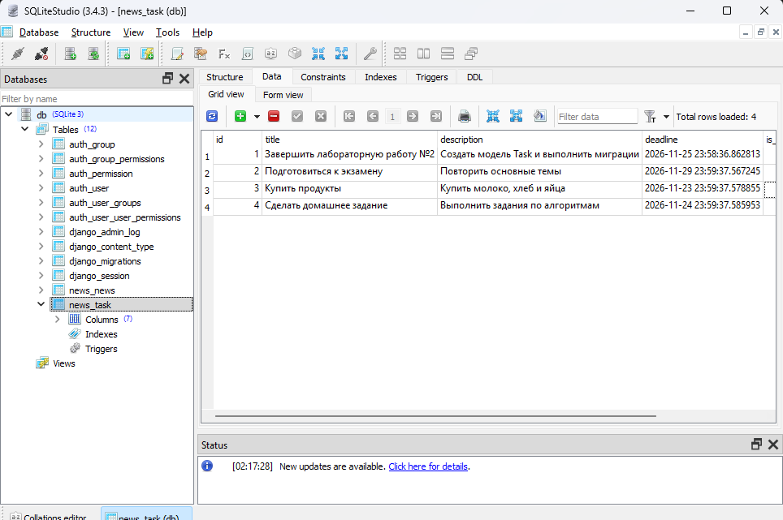

## 4. Контрольные вопросы

**1. Что такое модель в Django и для чего она используется?**  
Модель — это класс Python, наследующий `models.Model`, который описывает данные приложения и их структуру в базе данных. С помощью модели можно создавать, читать, обновлять и удалять записи.

**2. Какие типы полей вы знаете? Приведите примеры.**  
`CharField` — строка (`title`), `TextField` — большой текст (`description`), `DateTimeField` — дата и время (`deadline`), `BooleanField` — логическое значение (`is_completed`), `IntegerField` — целое число (`priority`), `ImageField` — изображение (`photo` в модели News).

**3. Чем отличаются параметры `blank=True` и `null=True`?**  
`blank=True` разрешает оставлять поле пустым при проверке данных формами, а `null=True` разрешает хранить в столбце базы данных значение `NULL`.

**4. Что такое миграции и зачем они нужны? Опишите основные команды.**  
Миграции — механизм фиксации и применения изменений структуры моделей к базе данных. `makemigrations` создаёт файлы миграций, `migrate` применяет их, `sqlmigrate` показывает SQL-команды определённой миграции.

**5. Как создать суперпользователя для доступа к административной панели Django?**  
В терминале проекта выполнить `python manage.py createsuperuser`, затем указать данные пользователя. После запуска сервера админка доступна по адресу `/admin/`, если соответствующий маршрут подключён.

**6. Что такое ORM? Перечислите основные методы CRUD.**  
ORM — способ взаимодействия с базой данных через объекты Python. Создание: `create()` и `save()`; чтение: `all()`, `filter()`, `get()`, `exclude()`; обновление: изменение полей и `save()`; удаление: `delete()`.

**7. В чём разница между методами `filter()` и `get()`?**  
`filter()` возвращает набор объектов `QuerySet`, в том числе пустой. `get()` возвращает ровно один объект и вызывает исключение, если объект не найден или найдено больше одного.

**8. Как настроить загрузку изображений (медиафайлов) в проекте Django?**  
Установить Pillow для `ImageField`, определить `MEDIA_ROOT` и `MEDIA_URL` в `settings.py`, а в корневом `urls.py` в режиме `DEBUG=True` добавить маршруты с помощью `static(settings.MEDIA_URL, document_root=settings.MEDIA_ROOT)`.

**9. Для чего нужен метод `__str__` в модели?**  
Он задаёт удобное текстовое представление объекта. Для модели `Task` метод возвращает название задачи `title`.

**10. Что произойдёт, если выполнить `makemigrations`, но не выполнить `migrate`?**  
Файл миграции будет создан, но изменения не применятся к базе данных. Например, новая таблица `news_task` не появится до выполнения `migrate`.

## 5. Вывод

В лабораторной работе рассмотрены модели Django, миграции, база данных SQLite и операции CRUD с помощью ORM. Для варианта 4 подготовлена модель `Task` с полями названия, описания, срока, статуса выполнения, приоритета и категории. Приведены команды для создания, чтения, обновления и удаления задач через Django Shell, а также для вывода невыполненных задач по приоритету.

